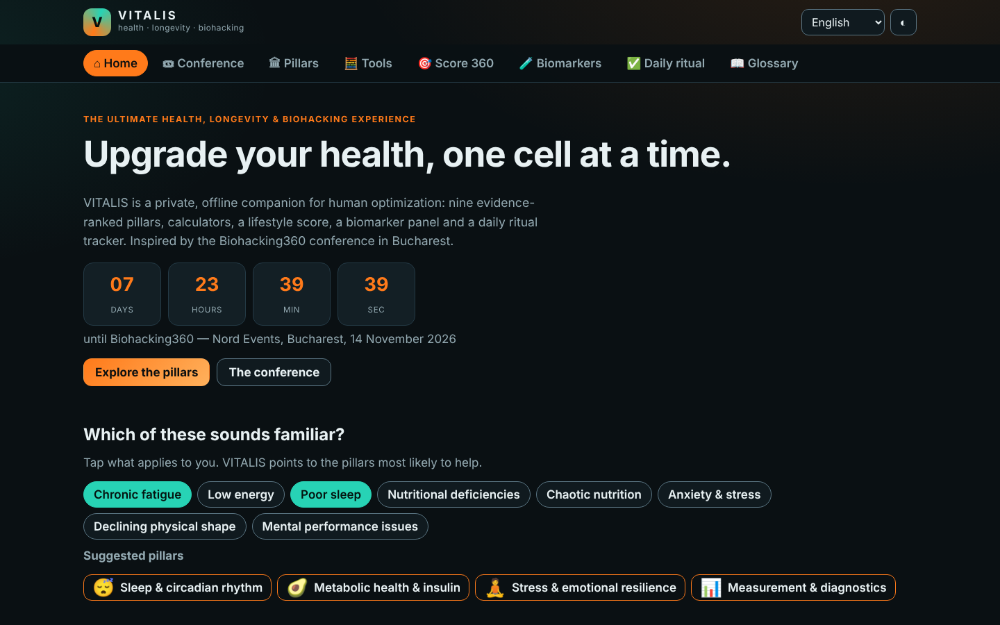
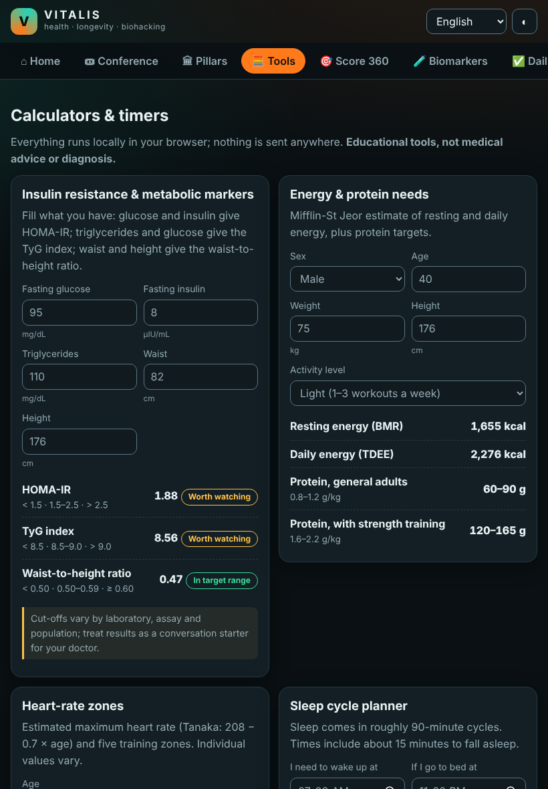
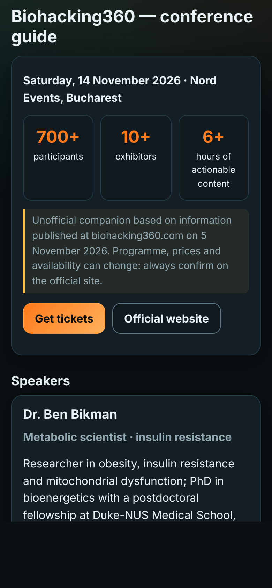

# VITALIS

[English](README.md) · [Română](README.ro.md) · **Français** · [Italiano](README.it.md) · [Español](README.es.md) · [Português](README.pt.md) · [Deutsch](README.de.md) · [Magyar](README.hu.md)

Compagnon santé, longévité et biohacking — fichier unique, hors ligne, sans commerce de données.

Version : 1.0.0 · Dernière mise à jour : 2026-11-06

**Application en ligne:** https://chiuta.github.io/vitalis/

 

## Fonctionnalités

- Neuf piliers classés par niveau de preuve, avec premiers gestes et pièges courants
- Compagnon de l'événement BioHacking360 (non officiel)
- Calculateurs : HOMA-IR, indice TyG, tour de taille/taille, Mifflin-St Jeor, zones de fréquence cardiaque, cycles de sommeil, objectifs en protéines
- Minuteur de jeûne et guide de respiration
- Score 360 avec graphique radar
- Valeurs de référence des biomarqueurs
- Rituel quotidien, glossaire et mythes
- 8 langues, thème sombre/clair, export/import JSON, PWA installable

## Confidentialité

Aucun suivi, aucun compte, aucune requête réseau (CSP : connect-src none). Les données restent dans le localStorage de votre navigateur.

## Avertissement

À titre éducatif uniquement, pas un avis médical. Consultez votre médecin avant de modifier traitement, alimentation ou entraînement. Compagnon non officiel basé sur des informations publiques de biohacking360.com.

## Utilisation

Ouvrez index.html dans un navigateur ou utilisez l'application en ligne et installez-la comme PWA.

## Licence

MIT © Alexandru-Ionuț Chiuță (Alexio)

## Soutenir

[Buy Me a Coffee](https://buymeacoffee.com/echo.of.the.strings)
